# 🛡️ AI Company Guardian

> **AI-Powered Authentication Log Monitoring, Threat Detection & SOC Triage Platform**  
> *Built with Python, Scikit-Learn (Isolation Forest), Streamlit, SQLite, and Plotly — ₹0 Open Source Stack.*

[](https://www.python.org/)
[](LICENSE)
[](https://streamlit.io/)
[]()

---

## 📌 Project Overview

**AI Company Guardian** is a real-world cybersecurity prototype designed for Security Operations Centers (SOC). It ingests enterprise authentication telemetry (CSV and JSON format), cleans and normalizes timestamps, deterministically deduplicates events, and applies a **dual-engine detection strategy**:

1. **Deterministic Rule Engine**: High-confidence detection of Brute-Force bursts, Credential Stuffing / Account Compromise sequences, Distributed Password Spraying, and Out-of-Hours logins.
2. **Unsupervised Machine Learning Engine (Isolation Forest)**: Identifies multidimensional anomalies and behavioral shifts without requiring historical attack labels.

Rather than merely displaying raw alert dumps, AI Company Guardian provides a complete incident lifecycle triage flow: **Investigate Forensic Timelines → Record Case Notes → Update Incident Disposition → Generate Executive Compliance Reports**.

---

## 🏗️ System Architecture

```mermaid
flowchart TD
    subgraph UI_Layer [Streamlit Multi-Page SOC Console]
        P1[1. Secure Authentication & RBAC]
        P2[2. Executive KPI Dashboard]
        P3[3. Log Ingestion & Schema Validator]
        P4[4. Security Events Explorer]
        P5[5. Alerts & Incident Triage Queue]
        P6[6. Deep Forensic Event Dossier]
        P7[7. ML Anomaly Analysis Hub]
        P8[8. Compliance & Reports Exporter]
        P9[9. System Settings & Policy Tuning]
        P10[10. Admin Identity Management]
    end

    subgraph Core_Engine [Application Logic]
        Auth[Auth & Salted Hashing Engine]
        Ingest[CSV/JSON Ingestion & Quarantine Engine]
        RuleEngine[Deterministic Rules Engine]
        MLEngine[Isolation Forest Unsupervised Model]
        Notifier[Notification Service - SMTP/Audit]
        Reporter[Markdown & CSV Executive Reporter]
    end

    subgraph Storage [SQLite Relational Database]
        T_Users[(users)]
        T_Imports[(import_jobs)]
        T_Events[(security_events)]
        T_Alerts[(alerts)]
        T_Notes[(investigation_notes)]
        T_Audit[(audit_history)]
        T_Settings[(system_settings)]
    end

    UI_Layer --> Core_Engine
    Core_Engine --> Storage
```



---

## 🚀 Key Features

| Feature | Description |
|---|---|
| **Role-Based Access Control (RBAC)** | Secure password hashing, session tokens, and strict role segregation between `Admin` and `Analyst`. |
| **Robust Log Ingestion & Validation** | Real-time schema validation for CSV and JSON files, automatic SHA-256 fingerprint deduplication, and quarantining of malformed rows. |
| **Rule-Based Threat Detection** | Detects brute-force bursts ($>5$ failures in 10 mins), account compromises (success following repeated failures), and IP password spray ($>10$ failures across multiple users). |
| **Unsupervised ML Outlier Scoring** | Feature-engineered Isolation Forest (temporal dynamics, rolling user failure velocity, IP cluster rarity) delivering normalized anomaly confidence scores ($0.0 - 1.0$). |
| **Interactive SOC Dashboard** | KPI metric cards, Plotly hourly activity bar charts, severity distributions, and active priority queue. |
| **Incident Triage & Forensic Dossiers** | Case status tracking (`New` ➔ `Investigating` ➔ `Resolved` ➔ `False Positive`), user timeline analysis, and audit notes. |
| **Compliance & Executive Reports** | One-click export of filtered events and alerts to CSV, plus formal Markdown security incident reports. |
| **Configurable SOC Policies** | Live tuning of brute-force thresholds, working hours schedules, ML sensitivity cutoffs, and simulated/live SMTP notifications. |

---

## ⚡ Quickstart Guide

### 1. Prerequisites
- Python 3.10+ installed
- Git

### 2. Installation
```bash
# Clone the repository
git clone https://github.com/your-username/ai-company-guardian.git
cd ai-company-guardian

# Install required open-source dependencies
pip install -r requirements.txt
```

### 3. Initialize Database & Synthetic Datasets
```bash
# Generate synthetic normal + attack datasets
python generate_data.py

# Initialize SQLite tables, default settings & seed accounts
python -c "from database.db import init_db; init_db()"
```

### 4. Launch the Web Platform
```bash
streamlit run app.py
```
Open your browser at `http://localhost:8501`.

---

## 🔑 Default Credentials

| Username | Password | Role | Permissions |
|---|---|---|---|
| `admin` | `Admin@Guardian2026` | **Admin** | Full system access, configuration tuning, user provisioning |
| `analyst` | `Analyst@Guardian2026` | **Analyst** | Triage queue, log ingestion, investigation dossiers, report export |

---

## 🧪 Automated Testing

AI Company Guardian includes a full pytest test suite verifying data validation, hashing, database persistence, rule triggers, and ML anomaly evaluation:

```bash
python -m pytest tests/ -v
```

---

## 📂 Project Structure

```
ai-company-guardian/
├── app.py                      # Streamlit entrance & page router
├── config.py                   # Global thresholds & configuration defaults
├── generate_data.py            # Synthetic log generator (normal + attack scenarios)
├── requirements.txt            # Python dependencies
├── database/
│   ├── db.py                   # SQLite tables, indexes & seeding
│   └── queries.py              # Transactional DB operations & KPI aggregations
├── core/
│   ├── auth.py                 # Password hashing & RBAC
│   ├── log_parser.py           # CSV/JSON parser, schema validator & quarantining
│   ├── rules.py                # Deterministic threat detection rules
│   ├── ml_detector.py          # Isolation Forest ML feature pipeline & benchmark
│   ├── notifier.py             # Email notification dispatcher (simulated & SMTP)
│   └── reporter.py             # Executive markdown & CSV report generator
├── pages_ui/
│   ├── ui_dashboard.py         # Main SOC executive KPI dashboard
│   ├── ui_upload.py            # Log upload & ingestion pipeline
│   ├── ui_events.py            # Filterable event telemetry explorer
│   ├── ui_alerts.py            # Incident triage & status management
│   ├── ui_investigation.py     # Forensic user timeline & evidence dossier
│   ├── ui_ml.py                # ML anomaly distribution & ground-truth benchmark
│   ├── ui_reports.py           # Compliance report generator & CSV export
│   ├── ui_settings.py          # Detection policy thresholds & audit trail
│   └── ui_admin.py             # Admin user provisioning & access control
├── data/
│   ├── sample_auth_logs.csv    # Synthetic realistic authentication logs
│   ├── test_labeled_logs.csv   # Ground-truth labeled benchmark dataset
│   └── guardian.db             # Relational SQLite database
└── tests/
    ├── test_auth.py            # Authentication & hashing unit tests
    ├── test_database.py        # Database schema & transaction tests
    ├── test_parser.py          # CSV/JSON parsing & schema validation tests
    ├── test_rules.py           # Brute-force & spray detection rule tests
    ├── test_ml.py              # Isolation Forest training & evaluation tests
    └── test_reporter.py        # Report generation & CSV export tests
```

---

## ⚠️ Limitations & Future Scope

- **Unsupervised Anomaly Scores**: Anomaly scores denote statistical variance from clusters, not guaranteed malicious intent. All alerts must be triaged.
- **Single-Node SQLite**: Suitable for prototypes, small teams, and portfolio demonstrations. For enterprise live production (100k+ events/sec), migration to PostgreSQL or Elasticsearch is recommended.
- **Future Roadmap**:
  - Live syslog / Fluentbit integration for automated streaming log ingestion.
  - Active directory / LDAP / OAuth2 single sign-on.
  - Automated response webhooks (e.g. temporary user suspension or IP blocklisting at firewall).

---

## 📄 License
This project is licensed under the MIT License.
