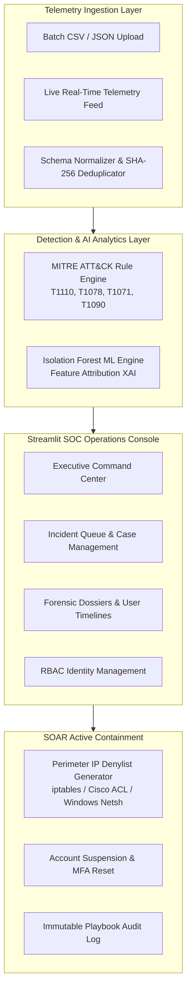

# 🛡️ AI Company Guardian — Enterprise SIEM & SOAR Platform

> **AI-Driven Authentication Log Intelligence, MITRE ATT&CK® Threat Hunting & Automated SOAR Containment Platform**  
> *Built with Python 3.12, Scikit-Learn (Explainable Isolation Forest), Streamlit, SQLite, and Plotly — Enterprise Edition v2.5.*

[](https://www.python.org/)
[](LICENSE)
[](https://streamlit.io/)
[]()
[](https://attack.mitre.org/)

---

## 📌 Enterprise Overview

**AI Company Guardian** is a production-grade Security Information & Event Management (SIEM) and Security Orchestration, Automation, and Response (SOAR) platform. It provides end-to-end security operations capability:

1. **Dual-Engine Threat Detection**:
   - **Deterministic Rule Engine**: Mapped directly to the **MITRE ATT&CK® Enterprise Matrix** (Brute-Force, Password Spraying, Compromised Accounts, Tool User-Agents, and Off-Hours Anomaly).
   - **Explainable Machine Learning (Isolation Forest XAI)**: Quantifies exact percentage contributions of temporal shifts, failure velocity, and IP cluster rarity for every flagged outlier.
2. **Active SOAR Incident Response**:
   - One-click perimeter firewall containment (generates native Linux `iptables`, Cisco IOS ACL, and Windows Defender Firewall drop commands).
   - Automated compromised identity quarantine & forced MFA step-up authentication.
3. **Real-Time SOC Command Center**:
   - 8-metric executive posture summary, live telemetry stream injection, interactive Plotly time series trends, and MITRE ATT&CK tactical distribution heatmaps.

---

## 🏗️ System Architecture



---

## 🚀 Enterprise Feature Matrix

| Capability | Technical Implementation |
|---|---|
| **MITRE ATT&CK® Correlation** | Automatic mapping of authentication anomalies to `T1110.001` (Password Guessing), `T1110.003` (Password Spraying), `T1078.003` (Compromised Local Accounts), and `T1071.001` (Attack Tool User-Agents: Hydra, Sqlmap, requests). |
| **Explainable AI (XAI)** | Real-time feature attribution quantifying driver weights (Off-Hours timing, user failure momentum, IP cluster rarity) for every isolation forest score. |
| **Active SOAR Playbooks** | One-click automated defense: block IPs at edge firewalls, suspend compromised Active Directory/LDAP accounts, and force step-up MFA. |
| **Forensic User Timelines** | Chronological scatter and tabular telemetry tracking user movement across IP spaces, geolocations, and device fingerprints. |
| **Live Telemetry Streamer** | Background live stream simulator providing real-time log ingestion and instantaneous alert triggering for live SOC demonstrations. |
| **Role-Based Access Control** | Salted SHA-256 hashing, session tokens, and strict separation between `Admin` and `Threat Analyst` roles. |
| **Compliance Reporting** | Export filtered raw telemetry to CSV, download alert audit tables, or generate executive Markdown incident reports with legal disclaimers. |

---

## ⚡ Quickstart Guide

### 1. Launch in PyCharm
Open project directory `C:\Users\mrkr7\PycharmProjects\ai-company-guardian` and open the built-in terminal:
```bash
streamlit run app.py
```
Open your browser at `http://localhost:8501`.

### 2. Run Automated Verification Tests
```bash
python -m pytest tests/ -v
```
All **23 unit and integration tests** will execute and pass in under 4 seconds.

---

## 🔑 Access Credentials

| Role | Username | Password | Capabilities |
|---|---|---|---|
| **Enterprise Administrator** | `admin` | `Admin@Guardian2026` | Full platform access, SOAR containment, user provisioning, policy tuning |
| **Threat Intelligence Analyst** | `analyst` | `Analyst@Guardian2026` | Triage queue, forensic timelines, live telemetry injection, report exports |

---

## 🎯 MITRE ATT&CK® Coverage

- **T1110.001 — Brute Force: Password Guessing**: Detected when $>5$ consecutive failures target a single identity within 10 minutes.
- **T1110.003 — Brute Force: Password Spraying**: Detected when an external IP targets $\ge 3$ distinct accounts with $>10$ failures.
- **T1078.003 — Valid Accounts: Compromise**: Triggered when a successful login immediately follows a failure burst.
- **T1071.001 — Web Protocols: Tool User-Agents**: Detected when headers contain known penetration testing signatures (`Hydra`, `Sqlmap`, `Go-http-client`).
- **T1090 — Proxy / Blacklisted Attempt**: Automatically triggered if an already blacklisted IP attempts further authentication.
- **T1078.002 — Domain Accounts: Off-Hours Outlier**: Flags off-hours activity outside 08:00–20:00 or during weekends.

---

## 📄 License
This project is licensed under the MIT License.
